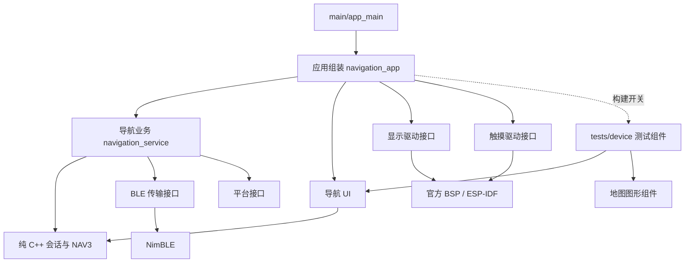

# 固件分层与接口（0.2.6）

本文件描述当前已实现的结构。主程序只组装模块；板级实现由独立 ESP-IDF 组件管理，应用不直接调用 BSP、NimBLE 或 LCD/I²C 接口。现有 NAV3 协议保持兼容。

## 目录

```text
moto_esp32/
├── main/
│   ├── app_main.cpp                  入口，只调用 app::run()
│   ├── app/
│   │   ├── navigation_app.*          启动顺序、模块组装、运行状态日志
│   │   └── navigation_service.*      BLE 事件/字节 → 导航会话；加锁快照
│   ├── CMakeLists.txt                应用依赖与可选测试装配
│   └── idf_component.yml             第三方版本锁定
├── components/
│   ├── motonav_display/              CO5300、QSPI/DMA、LVGL 显示端口
│   │   ├── display.cpp              缓冲所有权、条带窗口、显示锁与性能计数
│   │   └── qspi_panel.cpp           私有板级 QSPI 传输，应用不直接调用
│   ├── motonav_touch/                CST9217、方向映射、LVGL 输入适配
│   ├── motonav_ble/                  安全连接、NUS 字节传输、配对事件
│   ├── motonav_platform/             NVS 初始化、设备名、版本、时钟、内存
│   ├── motonav_core/                 纯 C++ 协议、会话、显示状态模型
│   ├── motonav_ui/                   导航页面、仪表控件、可选页面扩展接口
│   │   └── label_cache.*            私有的有界标签像素缓存，不接触驱动
│   └── motonav_graphics/             全屏地图投影、裁剪、RGB565 条带渲染
├── tests/
│   ├── device/motonav_bench/         可选设备测试组件，模拟地图也在这里
│   ├── host/                        协议、会话、状态、栅格和 QSPI 的 SDK 替身测试
│   ├── lvgl_host/                   正式/测试 UI 离屏回归和像素对比
│   ├── fixtures/nav3.frames         Java 编码的跨端测试样本
│   ├── navigation_protocol_test.cpp Android 跨端检查的兼容入口
│   └── run_host_tests.py
└── tools/
    ├── build.ps1                    正式/测试构建开关，不访问串口
    ├── capture_serial.py            指定串口的限时日志
    └── export_source.py             导出干净源码，默认不含 tests
```

每个组件只通过 `include/motonav/...` 暴露公共接口，私有实现不加入其他组件的 include 路径。CMake 使用显式 `REQUIRES/PRIV_REQUIRES`；开启最小组件构建，只有实际依赖进入链接。遵循 ESP-IDF 的 `components/` 约定，`main/` 因此只保留应用代码。



驱动不包含导航协议、页面或模拟数据；核心不包含 RTOS、LVGL 或硬件头文件；导航 UI 不包含任何驱动头文件。图形组件只接受相机与几何，不连接蓝牙，也不内置模拟路线。应用在启动时注入快照读取器；测试在启动时注入时钟/FPS 服务。

## 应用调用接口

| 公共头文件 | 接口 | 责任 |
| --- | --- | --- |
| `motonav/drivers/display.h` | `display_init / display_start` | 初始化固定板型的显示及启动 LVGL 服务 |
| 同上 | `display_lock / display_unlock` | 应用任务访问 LVGL 时的递归互斥锁，超时单位 ms，-1 无限等待 |
| 同上 | `display_set_brightness(0..100)` | 与绘制串行，等真实 DMA 完成后发送亮度命令 |
| 同上 | `display_enable_fps / reset_fps / read_fps` | 可选的真实传输完成帧计数，正式版默认不开启 |
| 同上 | `DisplayConfig` | 默认双 64 行内部 DMA 缓冲；16..64 偶数行可调，保留厂商 IO 对照路径 |
| 同上 | `display_enable_metrics / display_read_metrics` | 默认关闭的传输字节、命令、提交、DMA 和等待耗时；自行加锁 |
| `motonav/drivers/touch.h` | `touch_init(display, &input)` | 初始化并绑定 LVGL 输入；应用使用 LVGL 点击/长按事件 |
| `motonav/drivers/ble_transport.h` | `ble_start(name, revision, callbacks)` | 启动单连接加密认证 NUS 服务和广播；复制名称/版本 |
| 同上 | `ble_notify(data, length)` | 在 BLE 回调内回复通知，复制数据并报告资源/发送失败 |
| `motonav/drivers/platform.h` | `platform_init / device_name / firmware_version` | 初始化 NVS、板级身份、版本 |
| 同上 | `monotonic_us / monotonic_ms / memory_stats` | 单调时间与内存统计 |
| `motonav/core/navigation_session.h` | `NavigationSession` | 链路状态、配对/订阅、分片输入和只读快照；调用方负责串行化 |
| `motonav/ui/navigation_ui.h` | `create_navigation_ui` | 通过 `SnapshotReader` 拉取业务快照，默认无可选页面 |
| `motonav/graphics/route_map.h` | `create_route_map / render_route_map` | 创建地图对象，复制并投影有界几何；不拥有外部数据指针 |

初始化顺序见 `main/app/navigation_app.cpp`：

```cpp
ESP_ERROR_CHECK(drivers::platform_init());
ESP_ERROR_CHECK(navigation.init());
ESP_ERROR_CHECK(drivers::display_init(&display));
ESP_ERROR_CHECK(drivers::touch_init(display));
ESP_ERROR_CHECK(drivers::display_lock());
create_navigation_ui(display, name, reader); // reader 由应用实现
drivers::display_unlock();
ESP_ERROR_CHECK(drivers::display_start());
ESP_ERROR_CHECK(drivers::ble_start(name, drivers::firmware_version(), navigation.callbacks()));
```

这些驱动目前按单板、每次启动初始化一次设计。返回 `esp_err_t`，应用决定错误处置；初始化中途失败不支持原地重试或热卸载，应记录错误后重启。NVS 初始化失败不会自动擦除，保留已有配对数据。`ble_start` 底层资源初始化失败也按启动失败处理。

### 线程与数据所有权

- BLE 回调运行于 NimBLE 主机任务（CPU0），只更新业务状态和回复短通知，不调用 LVGL。不在其他任务或 ISR 中直接调用 `ble_notify`；后续主动上报应增加有界队列，把发送调度到 BLE 线程。
- RX 回调中的字节数组只在回调期间有效；一个回调可以包含半帧、多帧或任意片段。驱动不解析 NAV3。业务会话在取消订阅、失去安全状态或断连时清理半帧与握手；新握手后才恢复诱导。
- `NavigationService` 是业务状态的唯一持有者。快照复制与协议输入受互斥锁保护；释放业务锁后再发送 BLE 通知。UI 在 LVGL 线程通过读取器拉取快照，因此没有 BLE → LVGL 的跨线程写对象。
- LVGL 服务运行于 CPU1；SPI 中断仍在 CPU1 分配。双 64 行内部 RAM 缓冲、466 × 466、40 MHz QSPI、RGB565_SWAPPED、真实 DMA 完成信号量及 CO5300 连续条带逻辑保留。
- 默认 QSPI 使用 ESP-IDF 公开 LCD IO 扩展接口：8 位指令 + 24 位地址走单线，像素走四线；指令与像素放在同一片选序列。按 SDK 查询到的单次 DMA 上限分段（本机 32 KiB），仅最后一段触发显示完成，且回收 SPI 返回队列后才复用描述符。队列深度为 2，没有每帧动态分配或隐式 DMA 中转缓冲。
- 部分分段提交失败时先收回已接受的 DMA，再锁存故障阻止后续命令；若无法确认 DMA 已回收则终止运行，绝不虚构完成后复用内存。初始化失败不自动改用其他传输实现。
- SPI 热路径放入内部指令 RAM，减少 Flash 指令缓存未命中的影响；这不表示整条 LVGL/驱动调用链支持 Flash 缓存关闭期间运行。当前没有固件 OTA。
- 从普通应用任务调用 LVGL 时先 `display_lock()`，完成后解锁；LVGL 自己的事件和定时回调已经持锁。亮度接口自己加锁，并在完成上一笔 DMA 后操作面板。
- Dashboard 的点数组必须与页面同寿命。导航页持有自己的 Dashboard；测试组件创建独立 LVGL screen，退出时切回导航页并删除测试 screen，连同地图/仪表背景一起释放。
- `motonav_ui/label_cache.cpp` 独立管理 8 槽标签缓存，仅接受已验证的内置字体、ASCII 单行居中标签和实色背景；透明、渐变、多行、选中、旋转及其他字体交回 LVGL。圆角仍由 LVGL 绘制，缓存只复制实色中部。缓存键包含文字副本、绘制描述、尺寸、背景色与圆角；不保存可变文字指针作为内容依据。一个延迟分配的约 466 KiB 像素池按平台的大块分配策略进入 PSRAM，槽位复用，不逐帧分配；跨页面保留，LVGL 反初始化时释放。`label_cache_stats()` 只读命中/重绘/容量，调用时持 LVGL 锁。
- 地图接口调用必须持 LVGL 锁。路线最多 512 点、背景道路最多 64 段；输入在函数返回前复制/投影。当前自定义绘制单元依赖 LVGL 9.5.0 私有接口，不能单独升级 LVGL 而跳过回归。

## 正式构建与可删除测试

默认构建 **不含设备测试、模拟路线、自动测试或测试手势入口**：

```powershell
pwsh -File tools/build.ps1
```

需要在台架上手动切换负载时：

```powershell
pwsh -File tools/build.ps1 -DeviceTests
```

仅这个开发版本支持待机长按进入、短按切换、长按退出。自动测试仍支持：

```powershell
pwsh -File tools/build.ps1 -DisplayBench -BenchSeconds 123
pwsh -File tools/build.ps1 -MapBench -BenchSeconds 43
```

性能对比可用 `-DisplayRows 32` 调整两块缓冲的行数，或用 `-LegacyQspi` 切回厂商 IO。默认选用 64 行与直接 QSPI 路径；不是缓冲越小越快。应用直接调用 `display_init(&display)` 即获得默认配置，不需要了解 SPI 描述符或 DMA 分段。

设备分析器位于 `tests/device/motonav_bench/driver_probe.cpp`，为测试组件注入时钟/FPS/驱动计数，并监听 LVGL 渲染事件。`driver_profile` 的耗时可以重叠，不能相加当作帧时间；DMA 等待与绘制本来就在流水执行。`transfers` 是逻辑像素条带数，不是拆分后的硬件 DMA 事务数。正式构建不注册这个分析器，删除 `tests/` 不影响驱动。

0.2.6 增加 `draw_profile` 软件绘制任务耗时和 `map_paint` 地图栅格耗时；地图计时器由调用方注入，默认空指针关闭。软件任务分析器依赖固定的 LVGL 9.5.0 同步软件绘制模式，只存在于测试组件。主机离屏测试增加不启用缓存的参考构建，逐像素比较所有状态以及文字、颜色、尺寸、字体、位置、透明度、缓存替换和析构。

原 `CONFIG_MOTONAV_BOOT_DISPLAY_TEST` 已删除，避免 Kconfig 遗留值把测试带入正式包。脚本每次显式设置 `MOTONAV_DEVICE_TESTS`、`MOTONAV_AUTORUN_BENCH`、`MOTONAV_AUTORUN_MAP_BENCH`，无测试参数就全部关闭。直接使用 IDF 时要注意 CMake 缓存；恢复正式版使用：

```text
idf.py -DMOTONAV_DEVICE_TESTS=OFF -DMOTONAV_AUTORUN_BENCH=OFF -DMOTONAV_AUTORUN_MAP_BENCH=OFF build
```

**可整体删除 `tests/`，不需要修改任何生产源码或提供空实现。** 正式构建的测试开关必须关闭；删除后误开测试会收到明确 CMake 错误。项目的 GitHub Actions 测试任务会使用 tests，正式发布源码的编译不依赖它们。

验证或导出纯生产源码：

```text
python tools/export_source.py dist/source-production
```

在导出目录内正常执行 `tools/build.ps1` 即可。输出目录必须不存在；不导出本地构建目录、整片 Flash 备份、NVS 或下载依赖。需要交付测试源码时添加 `--with-tests`。

## 后续新增功能

新传感器或存储驱动新增为独立组件，公开小接口并返回真实读数/错误，不在驱动中创建页面。应用增加业务服务，UI 只接收状态；云端消息与地图路线接收也分别建立有界业务模块，避免重新塞回 `app_main.cpp`。

目前只封装已经接入的显示、触摸、BLE 与基础平台服务；未实现电池/充电、IMU、RTC、音频、TF 卡业务或固件 OTA。正式导航仍为 NAV3 仪表，真实路线输入尚待两端联调。全屏地图图形组件保留，模拟路线只存在于测试模块；性能验收只适用于 [0.2.6 实测报告](HARDWARE_TEST_0.2.6.md) 所列负载。
