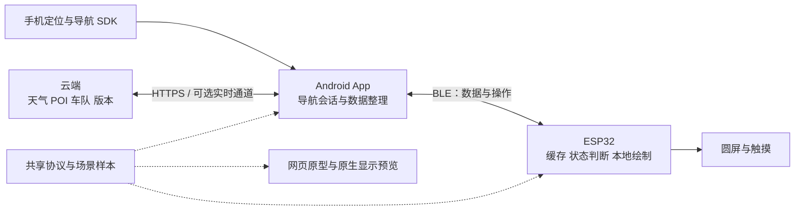

# MotoNav 项目整体架构

2026-11-12。面向现有 466 × 466 圆屏、ESP32-S3、32 MB Flash 和 8 MB PSRAM。本文规定下一阶段的设计方向；未实现的协议、地图、传感器和 OTA 均不作为已有能力。

产品目标是一个能在车把上清楚显示真实导航和在线信息的圆屏终端。手机负责定位、算路、导航会话和联网，ESP32 负责本地绘制、输入及设备状态，云端提供在线数据和版本分发。显示以仓库现有 [sim/index.html](../sim/index.html) 为视觉和交互基准，目标是在真实导航负载下达到至少 40 FPS。



## 当前基线

| 部分 | 已核对状态 | 下一步缺口 |
| --- | --- | --- |
| 网页原型 | main 的 `sim/index.html`，GTA 风格小地图、视角、轮盘及场景模拟 | 接收统一场景数据，明确区分模拟源和真实源 |
| Android | `codex/simple-navigation` 的 `418fd8d`，构建配置为 0.7.4 / versionCode 12；已有导航服务、NAV3 和固定签名更新代码 | 手机端导航联调、真实路线几何输出、偏航恢复及扩展协议；源码版本不代表手机安装或正式发布版本 |
| ESP32 | `codex/esp32-navigation-display` 的 `a4ef017`；COM21 已刷 0.2.1，用户确认显示和长短按正常 | 中文、小地图、在线卡片、设备遥测及 OTA |
| BLE | 已实现 PIN 配对逻辑、加密 RX、NAV3、ACK、时效和重连握手；实测扫描、连接、服务和版本读取 | 手机 PIN 配对和真实导航持续传输仍需实机联合验证 |
| 性能 | BLE 广播空闲时局部 HUD 最低/平均 59/59 FPS；全屏重绘约 31–32 FPS | 动态地图、真实 BLE 流量、触摸并发下的至少 40 FPS |

当前 Android 在偏航或路况重算事件发生时会停止导航。网页原型的自动重算、倾角、油量、在线车队和求救不是实际功能。旧版 v1/v2 模拟路网传输与 NAV3 真实导航分开，不能把模拟路网当作真实地图源。

## 各端职责

| 端 | 负责 | 关键边界 |
| --- | --- | --- |
| Android App | 权限和定位质量、摩托路线、导航 SDK、前台会话、路线裁剪、BLE 调度、在线缓存、设备配置、升级下载 | 导航服务独立于页面生命周期；位置和指令必须分别判断时效 |
| ESP32 | BLE 接收和校验、显示模型、地图与控件渲染、触摸操作、设备电量与传感器适配、OTA 接收 | 显示任务不能等待网络、BLE ACK 或 Flash 大块写入；不自行猜测转向 |
| 云端 | 天气和 POI 聚合、可选车队共享、版本目录、经用户开启的诊断 | 自建云端故障不应中断仍有有效数据的基础导航；导航 SDK 自身的网络依赖另行处理 |
| 模拟和测试 | 网页交互探索、统一场景回放、原生 LVGL 截图、跨语言协议测试 | 浏览器流畅不代表 ESP32 帧率；原生桌面预览也不能代替上板验收 |

先保留现有 Java Android、ESP-IDF、LVGL 和 NimBLE 实现，按职责拆分现有代码，不进行框架重写。独立于手机的模式另立产品阶段，需要补齐定位和独立联网链路；现阶段设备在脱离手机后进入明确的离线/待连接状态。

## 产品显示与操作

以原型的深色底图、路线高亮、转向卡、底部车速和外圈状态为主要视觉语言。原型中的特效根据显示预算逐项移植。

| 场景 | 正式显示 | 数据或实现前提 |
| --- | --- | --- |
| 导航主屏 | 顶部箭头、距离和路名；中间路线小地图；底部车速、剩余里程和到达时间；外圈方向/进度 | 可信导航快照、路线版本、字库与时间同步；限速仅在来源有效时显示 |
| 临近转向 | 加强箭头与距离，减少次要标签和提醒 | 使用导航状态；距离门槛需实测，不照搬模拟器常量 |
| 等待/断连/偏航 | 隐藏旧诱导，说明当前原因与恢复状态 | 分别表示蓝牙连接、导航生命周期和数据质量，避免用一个状态掩盖不同原因 |
| 快捷轮盘 | 首期四个大入口：导航、行程、天气、设置 | 长按呼出，短触确认/返回；触摸分区和戴手套操作需实测 |
| 行程与到达 | 里程、用时、到达摘要 | App 持久化统计；设备重启后由 App 恢复快照 |
| 天气与在线提醒 | 简短提示、地点和更新时间；详情在次级页 | 缓存与过期标志；普通消息不覆盖转向卡，临近转向时延后 |
| 待机/设置 | 时钟、连接、电量、亮度、日夜模式、版本和升级状态 | 电量和充电驱动接入后才显示真实百分比 |
| 后续可选 | 音乐控制、车队位置、倾角和事故辅助 | 分别需要手机媒体接口、实时服务、传感器校准和经过验证的检测流程 |

语音和音乐由手机或头盔音频设备输出，BLE 只传控制和状态。油量、转速、胎压需要真实车辆或外部传感器数据。倾角不是手机 GPS 航向，必须先核对板载 IMU、安装方向和融合算法。求救显示只有在实际发送链路确认成功后才可显示“已发送”；不能沿用模拟器仅凭倒计时结束就显示成功的逻辑。

当前固件长按仍进入显示测试。正式轮盘落地后，将显示测试移至停车诊断入口；本设计不会直接改变设备现有操作。

## 地图数据和至少 40 FPS 的实现路线

### 先完成真实路线，再接入周边底图

第一版小地图绘制手机发送的真实路线、当前有效位置、转向节点和必要 POI。背景可以是明确的空底或中性网格；不得把模拟器生成的道路和建筑作为真实周边环境显示。

App 已调用 `AMapNaviPath.getCoordList()` 读取路线坐标，官方文档也提供该接口。它提供的是路线点集，不代表已获得周边道路、建筑或可转发的矢量瓦片。周边底图单独验证数据供应、可导出内容、设备显示与缓存使用条件，再接入对应提供方。[高德路线接口](https://a.amap.com/lbs/static/unzip/Android_Navi_Doc/com/amap/api/navi/model/AMapNaviPath.html)

手机完成坐标统一、局部投影、裁剪与适度简化，保留转向节点和路线拓扑。线上数据声明坐标系、局部原点、尺度及路线版本，不能混用 GCJ-02 与 WGS84。ESP32 使用局部坐标，先实现二维路线，再验证受限的透视变换。预取当前视野和前方路线片段，长路线分块，整段验证完成后切换显示。

### 渲染与传输分开

- BLE 传导航状态、路线几何和事件；大块路线在建立、变化或缓存缺失时发送。已有 NAV3 约 1 Hz 快照保持兼容。扩展协议可在有效来源变化时及时发送，并以约 1 Hz 心跳维持状态；不通过提高重复发送频率伪造更新率。
- ESP32 本地以不超过 25 ms 的动态帧预算为目标。地图、控件和传输分别计时，画面由有限的新数据和本地动画生成。
- 相机可以平滑过渡到最新可信快照，但不能推算不存在的车速、距离或未来位置；视觉过渡不延长来源时效。失去有效数据后停止位置推进并隐藏旧诱导。

466 × 466 RGB565 一帧为 434,312 字节，40 FPS 的整屏有效像素负载约为 **17.4 MB/s**，还未包括命令、绘制和同步开销。当前全屏实测不足 40 FPS，因此第一版不采用手机传整帧或整屏持续透视重绘。

建议先验证中央约 **320 × 300** 的动态地图区域，外围使用稳定的状态、转向和车速布局。该区域 40 FPS 的原始像素负载约为 **7.68 MB/s**；这是预算计算，不是已达到的帧率。地图缓存用 RGB565，先分配两块该尺寸缓冲共 384,000 字节；其余内存按实测余量分配给字形和路线缓存，显示 DMA 继续使用现有内部 RAM 条带缓冲。不要直接搬入浏览器的 1200 × 1300 离屏画布。

渲染顺序：平面路线 → 有界密度的道路/POI → 夜间配色 → 受限透视。先裁掉屏外几何、缓存背景和字形、减少透明叠加及逐帧内存分配，再评估扩大地图区域。地图之外的数字只有变化时重绘。雨幕、星级、渐隐和整屏转场不进入首轮帧率验收。

FPS 按完整帧最后一次 DMA 完成计数，并确认帧有实际画面变化。至少持续测试 30 分钟，包含 BLE 导航、路线块传输、触摸和温度稳定后的运行；要求动态地图每秒采样窗口不低于 40 FPS，同时记录帧时间、丢帧、剩余堆、BLE 延迟和数据年龄。不能用“地图 15 FPS、其他动画 40 FPS”宣称地图满足目标；达不到时继续调整复杂度和更新区域。

## 蓝牙与共享数据契约

### 兼容和版本

保留当前 NAV3 的 UUID、格式、ACK 和时效规则，旧 App/旧固件继续使用箭头导航。扩展使用独立的新服务/特征及能力协商；正式 UUID、帧格式和长度常量需在 App 与固件开工前冻结，不复用旧 v1/v2 模拟协议。

每次连接选择一个实时导航输入：NAV3 或协商后的扩展导航快照，不能让两条流同时修改当前导航。扩展快照含导航核心字段及 `route_revision`，避免旧路线几何与新转向错配。扩展不支持或协商失败时清空扩展状态，再回到 NAV3。

| 消息类别 | 必需语义 | 调度方式 |
| --- | --- | --- |
| 能力/握手 | 协议版本、板型、固件、显示能力、最大消息/块大小、会话标识 | 每次连接重新协商 |
| 导航快照 | 模式、转向、距离、速度、来源年龄、有效性及原因、路线版本 | 最高优先级；队列只保留最新待发快照 |
| 路线/地图块 | 对象 ID、路线版本、原点和坐标系、块序号、总长和校验 | 有界分片、可暂停；完整提交前不替换现有对象 |
| 行程/时间/天气 | 值、单位、来源、采集时间、有效期 | 变化时或低频更新；过期独立处理 |
| 设备状态 | 电量、充电、能力、错误计数、可选传感器状态 | ESP32 向手机上报；与手机电量分开 |
| 用户操作 | 命令 ID、会话、动作、参数、确认结果 | 幂等处理；收到确认后才显示执行成功 |
| OTA | 目标板型、版本、大小、摘要/签名、偏移和完成状态 | 停车维护模式单独传输，正常导航优先 |

扩展建议采用有长度和类型的紧凑二进制帧；字符串为 UTF-8，数值单位固定，未知值显式表示。每类消息必须冻结最大长度、数组上限和重组超时。所有队列有界，路线和字体块在实时导航之间让出发送机会。MTU 23 必须可工作，更大 MTU 只作为协商后的优化；BLE 连通或 CRC 正确不能替代来源真实性与数据时效判断。

BLE 配对只负责近距离链路身份，云端账户和设备绑定另有身份。导航时效用单调时钟计算，手机墙上时钟只用于时间和预计到达显示。重传不能重置 age，重连不能复用旧会话和旧路线半成品。

## 软件组织和两端协作

以下是目标目录结构，不在本轮移动已有工程：

```text
sim/                         网页视觉与场景原型
android-recovery/            当前 Android 工程，保留包名和稳定签名
moto_esp32/                  设备固件与原生 LVGL 预览
protocol/                   NAV3 固定规范、扩展规范、公共枚举和测试帧
scenarios/                  正常导航、失锁、重连、偏航等共享样本
server/                     后续在线服务
docs/                       产品规格、兼容矩阵、发布和实测记录
.github/workflows/          分端构建、协议联测及受控发布
```

App 端按导航会话、位置质量、路线整理、BLE、在线数据和更新分工。固件在当前文件基础上逐步拆为接收/协议、状态模型、地图渲染、LVGL 控件、输入、设备驱动和 OTA。纯状态模型不依赖 BLE 或显示驱动，以便主机测试；UI 只在 LVGL 任务更新，回调通过有界消息传递。

网页原型逐步改为消费共享场景数据，模拟来源明确标记。原生 `tests/lvgl_host` 复用固件显示代码生成截图，对照网页确定的布局；Java 编码帧进入 C++ 接收测试，并增加路线版本切换、UTF-8、分片损坏、重复命令和超时样本。

App 开发者负责 `android-recovery/`，固件开发者负责 `moto_esp32/`。跨端变更先更新协议及样本，再分别实现，并记录兼容版本。当前云端 main 只有原型等基础内容，App 和新固件分布在开发分支；后续通过经过验证的 PR 形成一个完整集成基线，保留各自 worktree，不直接互相覆盖目录。

## 云端与远程更新

### 在线服务

第一阶段使用一个后端服务，提供天气/POI 缓存、设备配置同步、可选车队会话和诊断入口，按模块组织；实际有持久数据后接数据库，升级包放对象存储或现有发布平台。车队需要实时更新时再增加带认证的实时通道，不让所有设备维持无用途的长连接。

天气请求与导航解耦，所有回复带地点、来源时间和 TTL。App 负责缓存与失败重试，圆屏显示过期状态。车队需用户主动加入/退出、明确共享范围；诊断默认记录版本、错误码、帧率和连接计数，精确位置日志沿用主动开启的诊断流程。AI 领航员只生成可核对的 POI/天气建议，由结构化来源支持，不直接生成转向或改变导航路线。

### App 更新

继续使用现有固定签名 APK、GitHub Releases、下载校验和 Android 安装器流程。当前 Android 更新清单 schema 1 恰好允许八个字段，不能直接加入固件字段；新能力用独立清单或显式升级 schema。无需为了圆屏上线重新开发一套 APK 更新系统。

### ESP32 更新

推荐先做“手机下载并校验固件 → BLE 分片传送 → ESP32 写入备用应用槽 → 完整校验 → 切换启动 → 自检确认/失败回退”。协议同时校验目标板型、Flash/分区布局版本、固件版本、镜像大小和兼容能力；镜像或发布清单使用可验证签名，SHA-256 只用于完整性检查。OTA 应在停车和供电条件满足时运行，并提供中断后的明确恢复方式。

当前设备只有 6 MB factory 应用槽，没有 OTA 槽。应趁设备仍能连接 USB 时，备份并迁移一次支持 OTA 的分区布局，再进行后续远程升级。分区表需按最终镜像和资源大小验证；建议预留两个足够大的应用槽、`otadata`、NVS 和字库/地图缓存区，不在设计阶段直接改写设备。

ESP-IDF 的应用 OTA 使用两个 OTA 应用槽和 OTA 数据分区；启用回退后，新应用自检通过才标记有效。分区表迁移不等同安全的常规应用 OTA，需要单独的恢复方案。[ESP-IDF 5.5.4 OTA 文档](https://docs.espressif.com/projects/esp-idf/en/v5.5.4/esp32s3/api-reference/system/ota.html)

以 BLE 作为第一条升级传输路径，先实测吞吐与传输时间；接口保留其他传输实现的空间。如后续升级包明显增大，再验证设备经手机热点/Wi-Fi 下载的方案。版本提醒、文件传输、安装和自检成功是不同状态，不能收到最后一个分片就报告升级成功。

Android 与固件发布使用不同标签和清单，固件 Release 不应替换 Android 更新器依赖的 `releases/latest` 入口。两者共享一份兼容矩阵；固件 OTA 清单使用独立稳定入口及明确板型，防止 App 更新、固件升级和分区迁移相互混淆。

## 交付顺序与验收

| 阶段 | 可交付结果 | 验收重点 |
| --- | --- | --- |
| A 真实链路 | PIN 配对、NAV3 导航、中文状态与基础主屏；冻结扩展数据和场景样本 | 手机锁屏、定位失效恢复、断连重连、结束/到达；不显示失效诱导 |
| B 早期升级基础 | OTA 分区/恢复设计，USB 迁移测试，手机代理固件升级 | 错误镜像拒绝、中途断连/断电、启动失败回退、最终版本确认；不影响稳定 APK 渠道 |
| C 原型主界面 | 扩展协议、中文路名、真实路线小地图、外圈/车速/行程、四入口轮盘 | 实际动态地图与 BLE 并发持续至少 40 FPS；来源有效、几何版本一致 |
| D 在线信息 | 设备电量、时钟、天气、POI 和简短提醒 | 弱网、缓存过期、低电量、提醒优先级和导航不中断 |
| E 可选扩展 | 周边底图与透视、车队、媒体控制、传感器辅助 | 各自数据来源、权限、性能和实机验证；事故辅助单独验收 |

阶段 C 的地图渲染性能小实验应在阶段 A 开始时提前做，尽早确定地图区域和复杂度，避免协议及美术完成后才发现硬件预算不够。正式在线功能依赖前面真实导航链路，不用模拟成功状态替代验收。

近期任务：App 端提供真实 NAV3 会话和路线点集样本；固件端完成手机联调、中文主屏和有界地图渲染实验；双方冻结扩展协议，随后完成一次 OTA 基础迁移。0.2.2 已开始实现明确标记的局部地图性能实验，正常导航仍使用 NAV3 箭头显示；具体进展以相应实测记录为准，本文基线保留设计时的版本快照。
