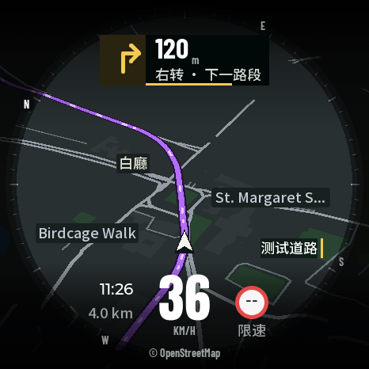

# Camera coverage and perspective road surfaces — 0.3.13 / 0.7.21

This is the first implementation after `visual-parity-gta5-2026-11-17.md`:
camera-dependent real-map selection and projected road/route surfaces. It does
not claim full simulator parity or completion of the remaining annotation,
route-progress, icon and animation work.

## Implementation and boundaries

- Android `MapViewport` mirrors the device camera's speed, heading, pitch and
  anchor. Inverse screen coverage includes a 120 m margin and is bounded to
  +/-1900 m. `Basemap.visibleTiles` requests at most nine tiles at z14 or lower.
  WAIT uses its actual framing preset and does not invent driving speed.
- `MapDetailSelector` separates water, green areas, roads and buildings, ranks
  projected coverage and distributes objects across screen cells. Geometry
  remains limited to 384 primitives, with 192 for progressive previews. An
  object is retained or omitted as a whole; roads can split at existing vertices.
- `MapPolygon` uses bounded even-odd tessellation for polygon holes. Courtyard
  interiors stay empty; objects beyond the existing complexity budget can
  still be omitted. This is not a promise of complete provider coverage.
- The loader finishes an in-flight request for the same route origin, keeps
  the last received display scene while replacements arrive, and limits camera
  refresh requests to at least 1.5 s apart. Location validity is unchanged.
- ESP `MapStroke` projects ground widths 2.8/5/6.5 px for roads (highway outer
  edge 10), and 8/13 px for route fill/edge. Bodies are exact homographies;
  round caps use local projected ellipses. The old overview path is preserved.
- Prepared polygons and strokes occupy compact typed pools in a bounded PSRAM
  scene. Draw strips reuse this geometry. There is no new full-frame canvas,
  DMA buffer or per-frame allocation. Public driver and navigation interfaces,
  NAV4S5 and the GATT service table are unchanged.
- Palette lookup, label collision broad-phase checks and unchanged text colors
  avoid repeated work. `CONFIG_LV_OBJ_STYLE_CACHE=y` adds eight bytes per LVGL
  object; an existing sdkconfig must enable it explicitly.

Names still have the prior 24 received / 8 visible limits. Icons retain the
existing glyph design. Explicit SDK route progress, continuous route highlight
phase, bridge/tunnel ordering, area HUD and independent camera smoothing remain
subsequent work. No nearest-point guess is used to infer progress through a
self-intersecting route.

## Reproducible source data and host checks

The cached public London tile is unchanged, SHA-256
`ab9c6c7141397dcdf316eb140a576716515c8f60618ab6c8b1d59bb5549ee85f`.
The LIVE 36 km/h fixture now contains 384 primitives: 44 minor roads, 101 major
roads, 160 building triangles, 47 water triangles and 32 park triangles, plus
24 labels. These counts are primitives, not buildings or named places. ODbL
attribution and reproduction instructions are in `tests/fixtures/REAL_MAP_SOURCE.md`.
The route and movement remain explicit test inputs, not the user's location.

`MapGeometryTests` passed 389 checks including courtyard area, winding order,
camera coverage across 180 speed/heading/latitude combinations, bounded tile
counts, context budgets and deterministic selection. The complete Android
host suite passed. Source CI for Android commit `68a28d8` passed verification,
APK build/lint and the then-current firmware production checks.

Firmware host checks cover projected widths, clipping, buffer guards and exact
whole-frame/strip equivalence. Twelve LVGL checks passed with the style cache,
including cached/uncached text, direct/decoder map paths and RGB332 reference
pixels. Enabling the style cache did not change the fixed real-map LIVE pixels.

## COM21 renderer comparison on the original 383-primitive fixture

RGB565, 40 MHz QSPI, double 64-row DMA buffers, unchanged synthetic movement.
Each timed run is about 40.5 s after warm-up. Instrumented dispatch changes
timing, so the table records it and is not a strict uninstrumented speedup claim.

| Build | Dispatch profiling | Min / mean FPS | Prepare us | Render us |
| --- | --- | --- | ---: | ---: |
| 0.3.12 delivery | off | 18 / 23 | 2794 | 37766 |
| Initial perspective implementation | on | 16 / 20 | 7015 | 38449 |
| Compact pools and analytical caps | off | 17 / 22 | 5523 | 36168 |
| Shared projection / label broad phase | on | 17 / 22 | 4982 | 36530 |
| With LVGL style cache | on | 18 / 23 | 4959 | 34879 |

Last measured preparation: geometry 4301 us, annotations 390 us, HUD 267 us.
DMA averaged 19705 us, overlapping rendering; it must not be added to render
time. Map rasterization averaged about 11 ms/frame. Test free internal heap
was about 25 KB versus roughly 7 KB in the previous labelled test. No panic,
assertion or watchdog was observed in these captures. The 40 FPS target is
still unmet. The new data extract is a different workload and is recorded
separately when validated; it must not replace the identical-input comparison.

## Final delivery checks

Firmware source: `b95adaf80d577c45f437435935d105cb7ea51e41` on
`codex/ble-diagnostics`. Android tag `android-v0.7.21` points to
`68a28d8d4804af9640bfb2c4164b9dcef0023747`; the subsequent firmware commit only
changes the Android test fixture generator, not the released app behavior.

- [Source CI](https://github.com/gargamelzhao0-del/motonav/actions/runs/44021894840)
  passed both jobs: Android checks/build/lint and firmware host checks, a clean
  production export without tests, optional benchmark compilation and LVGL tests.
- The [Android release workflow](https://github.com/gargamelzhao0-del/motonav/actions/runs/44021646223)
  passed. The downloaded APK independently passed local apksigner v2/v3
  verification, aapt package/version inspection, and size/SHA-256 checks.
- Final local firmware host checks and all 12 LVGL checks passed on the updated
  fixture. `verify_production.py` confirmed no test component or simulation in
  the normal image. A source export without `tests/` is included in the delivery.

| Artifact | Bytes | SHA-256 |
| --- | ---: | --- |
| MotoNav-0.7.21.apk, version code 29 | 105779997 | `64d8837296dafa8e67cfde42fc264c29d63ed00a66b70692b44b92ac479a9c81` |
| Normal firmware motonav.bin | 4781744 | `fcc0f0b4c864683840841a225063d1b07fbb2c32e18817bce22469a8f6d7b5b6` |
| Firmware source-b95adaf.zip | 5254147 | `69abae1f7252dbd5f122ee32c74088e41f2f7c6d20e396c50f31e4f801dc5c6d` |

APK signer remains
`af9e2f4cb0997fe77ae884e9d7797a7c6b933c1bfdebc3993386ae418aeacde1`.
The [signed update](https://github.com/gargamelzhao0-del/motonav/releases/download/android-v0.7.21/MotoNav-0.7.21.apk)
can cover the existing stable installation. Map Key, preferences and pairing
are retained. The APK is also copied into the user's original `motonav/apk/`.

The new 384-primitive, 24-label extract was measured on COM21 with dispatch
profiling off: minimum **18**, mean **23 FPS**, 36 samples over 40557 ms after
warm-up. Preparation averaged 5024 us (geometry 4362, annotations 402, HUD 259),
rendering 35062 us and overlapping DMA 19703 us. The continued hold animation
reached minimum **16**, mean **22 FPS** at 75 samples. Its lowest observed free
internal heap was about 24.8 KB. These figures are a different data workload
from the 383-primitive comparison above and remain below 40 FPS.

This is a native 466x466 host rendering of the public London tile with synthetic
guidance. It is neither a photograph of COM21 nor the user's position. Data:
© OpenStreetMap contributors, ODbL; see the fixture source notes.

After the visual test hold, COM21 received the verified normal image at 0x10000
on 2026-11-17 around 13:14 Asia/Shanghai. USB identity was checked as 303A:1001,
serial C4:9E:7E:0C:51:C8, BLE MotoNav-51CA. The write preserved bootloader,
partition table and NVS. Boot reports firmware 0.3.13, `device_tests=0`,
`ble_diagnostics=1`, free internal heap 26655 bytes and main-task stack minimum
3408 bytes while idle. The capture contains no panic/assert/watchdog. A passive
one-hour serial diagnostic logger was started without resetting the device.

User confirmation of this new visual test and the updated real phone map is
still pending at delivery; normal boot and synthetic measurements do not
establish real-riding navigation performance or complete simulator parity.

Local detailed evidence: `moto_esp32/dist/map-integration/0.3.13/`.
Normal image, ELF, source archive, manifest, flash log, monitor metadata and
validation results: `moto_esp32/dist/release-0.3.13/`. Firmware/protocol changes
are synchronized to the user's original checkout after baseline and conflict
checks. Android source remains in the isolated checkout.
