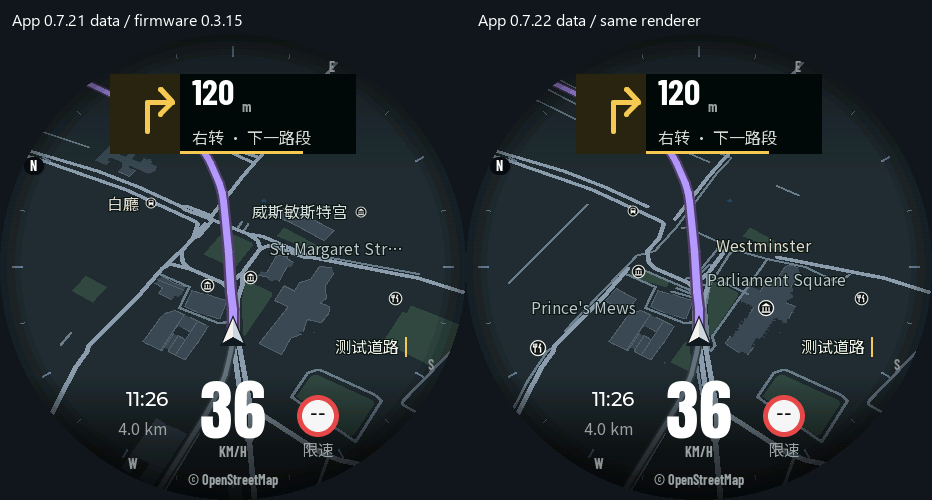

# App map acquisition and information retention — Android 0.7.23

Date: 2026-11-17 (Asia/Shanghai). Final App versionCode 31 (0.7.23), following
the initial 0.7.22 implementation. Compatible with the
installed ESP32 0.3.15 / NAV4S5; this change does not modify production firmware,
GATT services, navigation validity or the position policy. COM21 was not reset
or reflashed for this change.

## Findings

The live 0.7.21 / 0.3.15 session reported 350 map primitives, 19 names and no
map rejection. That proves reception of the selected scene, not completeness
of provider data. The phone's visible SDK map is AMap; device background geometry
and names come from a separate OpenStreetMap Shortbread source.

Confirmed losses in the previous App pipeline:

- A failed tile exited the entire region load, skipping later valid neighbors.
- Expired cached regions were deleted before the replacement download succeeded.
  A damaged fresh cache could fail repeatedly until its seven-day expiry.
- Buffered tile duplicates could consume geometry or name candidate capacity.
- Different POIs of the same category within 15 m were incorrectly merged.
- A complete object exceeding 96 triangles was silently rejected, even when it
  could fit the 384-primitive scene. Another 64-vertex polygon cutoff removed
  otherwise representable outlines.
- Ocean, point-based street names, grassland and several real path types were
  ignored. The decoder also discarded unknown layers without reporting counts.
- Detail ranking still used the older 50-degree camera, while installed firmware
  uses 35 degrees. Unknown headings could revert the selection to north while
  firmware retained its previous heading.

The provider is explicitly a general-purpose, reduced OSM schema, not all OSM
attributes or all information shown in AMap. See the official
[Shortbread schema](https://shortbread-tiles.org/schema/1.0/) and the current
[source metadata](https://vector.openstreetmap.org/shortbread_v1/tilejson.json).
The provider's maximum data zoom is 14; requesting nonexistent higher zooms
would not recover additional detail.

## Implemented changes

`MapTileStore` retains complete validated MVT bytes independently of device
selection. Fresh tiles remain cached for at least seven days. Old validated
tiles can serve as an explicitly stale fallback; a failed replacement never
renews their timestamp. Corrupt cached bytes trigger a fresh fetch. Cache
eviction only removes expired entries when capacity is needed. Downloads remain
limited to the viewed region; no offline bulk fetch was added.

The new pure `MapRegionLoader` isolates per-tile I/O/decoder failures, continues
with valid neighbors, reports missing/stale tiles, and checks cancellation
before publication. `BasemapLoader` retries incomplete regions after 30 seconds.
Its retained-scene watermark prevents the first cached tile of a retry from
replacing a richer scene; identical scenes are not repeatedly uploaded. Retry
time is set before callbacks can re-enter the request path. A final review found
that equal-coverage intermediate data (one cached tile, 192 primitives) could
still replace a previous one-tile final result (up to 384). Version 0.7.23 adds
an explicit publication policy: equal-coverage replacement waits until every
tile has been attempted; failed/less-complete attempts keep the retained map.

`LocalMapBuilder`, `MapDetailSelector` and `LocalMapLabels` retain these separate
responsibilities:

- Project and clip real source geometry into the existing radio coordinate range.
- Rank using the 0.3.15 camera while retaining wider legacy download/clip bounds
  for movement and transitions. Hold an established bearing when unavailable or
  while the live device view is holding at standstill.
- Canonicalize line direction and triangle winding without changing coordinates;
  deduplicate buffered objects before they occupy candidate queues. Shared
  already-selected primitives do not consume a second radio slot.
- Admit complete objects up to scene capacity; count objects that still cannot
  fit. Building courtyard triangulation remains independent of transport.
- Retain ocean, grassland, point road names, and minor foot/cycle/path context.
  The latter have lower selection priority than ordinary roads. Railways are
  not reclassified as roads. Cartographic background does not supply routing.
- Deduplicate names before candidate capacity is applied. Name and category
  must both match; different neighboring POIs remain separate. Rank labels in
  screen space so offscreen names do not occupy the visible-name budget.

## Auditing the chain

The App diagnostics page now distinguishes tile acquisition, source quantities,
selection and final device acknowledgment. `MapQuality` contains only counts:
no coordinates, tile IDs, place names, endpoints, keys or destinations. Building
counts are exterior rings, because a provider can pack many footprints into one
MVT feature. Source counts can include tile overlap and the wider coverage margin.
Candidate counts are processing counts, not a percentage of unique visible objects.

`map_delivery` is emitted only after the final geometry and, when negotiated,
label ACK. Disconnect clears current-delivery status. Starting diagnosis after
a map was loaded records the current acquisition and delivery snapshots.
The local diagnostic export and optional HTTP collector understand these count
records. The existing 88-byte BLE DIAG1 positioning summary is unchanged and
does not forward the new detailed map records.

Normal App status distinguishes incomplete surroundings, stale fallback and
source regions without useful supported content. Navigation/position messages
still have priority over map transfers.

## Validation

- Full `android-recovery/tests/run.sh` passed, including Java/C++ protocol
  fixtures, corruption/expiry handling, updates, diagnostics and controller checks.
- 31 targeted map-quality checks cover failed-neighbor isolation, stale fallback,
  corruption repair, cancellation, 120-triangle complete objects, duplicate
  direction/winding, nearby distinct names, visible-label selection, headings and
  equal-coverage retry publication.
- 389 geometry checks passed, including coverage, courtyard area and dense scenes.
- 134 actual `BleLink` callback checks passed, including the final-ACK reporting
  boundary and zero-name replacement. These use platform doubles, not a radio.
- 54 actual `Diagnostics` checks passed, including blocked I/O, bounded queues,
  snapshotting a previously loaded map and clearing old delivery on disconnect.
- A real cached London tile was decoded, encoded through production NAV4S5,
  fed into the C++ receiver, and rendered by the unchanged 0.3.15 native LVGL UI.
  Waiting/live/expiry/position checks passed. Preview CLI optionally accepts a
  scene fixture; existing default regression fixtures remain unchanged.

The fixed London tile contains 7,331 MVT features: 2,559 street-layer features,
1,300 building exterior rings, and 3,739 supported label features. The selected
camera run produced 4,314 candidate primitives, admitted 384, and retained 24
of 200 name candidates after 93 duplicate-name merges. Three complete geometric
objects exceeded representable capacity. There were 1,166 unsupported or
unconvertible feature records, including omitted schema layers and non-road
transport types. These numbers describe this fixture, **not the user's location**.

The emitted geometry contains 83 minor/context lines, 61 major-road lines,
161 building triangles, 47 water triangles and 32 green-area triangles. The
unchanged 384/24 bound limits transfer and rendering work; it is not a claim
that all source information fits on the device. The UI additionally hides
colliding names and reduces annotation density near turns.

Both images are native renders of the same fixed source area and synthetic
guidance, not device photographs or phone GPS captures. Data: © OpenStreetMap
contributors, ODbL; source provenance is retained with the existing real-map
fixture. No new hardware FPS result is claimed; changed geometry can change
rendering cost even at the same primitive count. Full source/screen parity and
the 40 FPS target remain unmet.

Local evidence is in `moto_esp32/dist/map-quality-0.7.22/`: full-tests-final-0.7.23.log,
actual-map-final.log, native-preview-new.log and the generated radio fixture.
Release/CI status, signed-APK digest and signer verification are recorded with
the delivered APK after the release workflow completes. Installation and real
phone scene acceptance remain separate from these automated checks.
