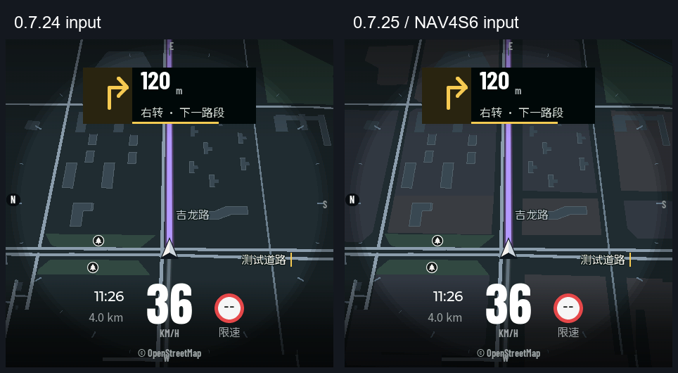

# Real map categories — Android 0.7.25 / ESP32 0.3.16

Date: 2026-11-17 (Asia/Shanghai). Android versionCode 33. NAV4S6 adds real
land/site/waterway categories while preserving old peers, GATT services,
navigation validity, position history and the RGB565 / 40 MHz QSPI configuration.

## What the supplied diagnostic counts establish

The App 0.7.24 report was: tiles 2/2, failures/stale 0, source line features
331, building exterior rings 1158, label features 440, selected/acknowledged
157 primitives and 11 labels, unsupported/unconvertible 88. All selected data
was acknowledged. This report does not indicate a Bluetooth map loss or a
384-primitive overflow. Source counts describe whole tiles, not the round view.

The two public Shortbread tiles surrounding the supplied public landmark,
陆肖地铁站 in Chengdu, reproduce all four source counts exactly. Their 88
unsupported features in the 0.7.24 pipeline break down as follows:

| Source group | Features | Previously omitted examples |
| --- | ---: | --- |
| sites | 51 | Construction 23, school 16, hospital 4, parking 3, prison 2, sports centre 3 |
| land | 14 | Brownfield 2, commercial 2, farmland 2, industrial 2, orchard 1, playground 1, residential 2, retail 2 |
| water_lines | 13 | Real waterway centerlines |
| streets:subway | 10 | Subway lines, still not rendered as roads |

This matches the reported source region; it does not recover the user's exact
phone location, camera state or heading. The independent public-scene origin,
tile URLs, hashes, license and synthetic guidance are documented in
[fixture provenance](../moto_esp32/tests/fixtures/LUXIAO_MAP_SOURCE.md).

## Changes and bounded responsibilities

The MVT decoder now retains water_lines. LocalMapBuilder maps supported source
categories to semantic primitives and clips them; MapDetailSelector retains
whole objects within independent context/road/building budgets. The transport
negotiates NAV4S6 before sending kinds 6/7/8. The receiver validates entire chunks
before publication. The graphics component paints ordered layers; UI annotation
placement stays separate. Generic park-category words no longer occupy name
slots, while their icons remain eligible. Drivers and navigation state are unchanged.

Old firmware negotiates down to NAV4S5 or earlier and receives supported kinds
only. Reconnecting to an older peer clears capability-dependent map selection;
cached new-category scenes are blocked at the send boundary. Capacity remains
384 primitives and 24 names. No network POI enrichment or fabricated detail was added.

## Same-place comparisons

The fixed public station test uses source 吉龙路 geometry and a synthetic
36 km/h LIVE navigation state. At identical pose, heading and viewport:

| Pipeline | Selected primitives | Labels | Unsupported/unconvertible |
| --- | ---: | ---: | ---: |
| Original 0.7.24 classes | 199 | 12 | 88 |
| 0.7.25 / NAV4S6 | 320 | 12 | 10 |

Both inputs below use the current production renderer, isolating source
selection differences. They are software renders of a fixed public scene,
not screenshots of the user's phone or a claim of live GPS verification.

A separate WAITING/north-origin replay at headings 0/90/180/270 degrees produced
204/155/169/229 primitives before and 322/242/276/321 after. New-pipeline ignored
counts were 11/10/11/11: 10 subway features plus one industrial polygon fragment
that failed conversion in three views. That remaining geometry case is counted,
not silently presented as complete. The feature's other usable pieces and the
rest of the tiles remain available.

## Verification

- Full Android host suite passed, including 149 production BleLink checks,
  19 new category/selection/wire checks and 28 Java-to-C++ compatibility checks.
- Full firmware host suite passed: protocol transactions, real driver ownership,
  diagnostics and dependency boundaries.
- All 14 native LVGL tests passed, covering normal/test builds, public-scene replay,
  expiry/STOP, annotation placement, route progress, RGB332 reference equivalence,
  and cache equivalence. New overlap checks ensure land/site/water layers cannot
  cover road surfaces even when input order is reversed.
- The Windows host harness reserves 8 MiB for its pixel-reference snapshots,
  matching typical Linux test-process stack capacity. This resolves a MinGW
  2 MiB stack overflow in the retained-animation test; firmware stacks are unchanged.
- Production ESP-IDF build excludes device tests. The station benchmark lives
  entirely under tests and is selected explicitly with `-LuxiaoScene`.

COM21 ran a 43-second RGB565/40 MHz map benchmark with the new 320-primitive,
12-label public scene at 35-degree pitch and synthetic route movement. After
warm-up: 36 samples, measured 40,565 ms, **minimum 21 / average 21 FPS**. The
display profiler reported roughly 40,226 us rendering per frame, 19,603 us DMA,
4,025 us map preparation (3,405 geometry, 356 annotations, 262 HUD). These timings
overlap and must not be summed as independent frame stages. There was no crash,
watchdog or reported display-transfer fault; the timed test returned to normal UI.
No user visual confirmation was received for this specific run. This scene is
different from the earlier London fixture, so its FPS is not a controlled
before/after renderer-speed comparison. **The 40 FPS requirement remains unmet.**

COM21 was then flashed with the normal 0.3.16 build. Flash hashes verified;
the 18:43 local startup reported `device_tests=0 / ble_diagnostics=1`, successful
panel initialization, 26,547 bytes free internal memory while idle and no fault.
The previous one-hour passive monitor had finished naturally before flashing.
A new passive monitor was started after normal firmware installation.

Real-phone 0.7.25 installation, live GCJ-02 alignment and new-layer acknowledgment
still require the phone update and a navigation session. OSM source coverage,
bounded geometry, small-polygon conversion and annotation avoidance remain
limitations; adding map categories cannot supply missing businesses or names.
