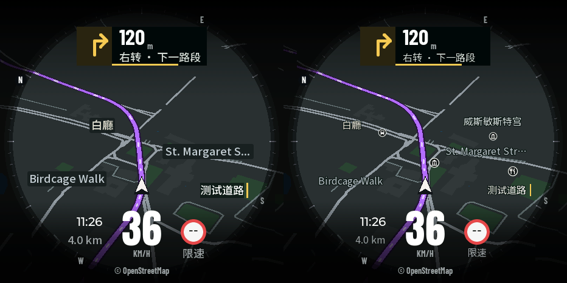

# Map typography and independent POI layout — firmware 0.3.14

This iteration addresses the reported coarse text/icons and crowded map. Android
0.7.21 remains compatible; no phone update, GATT change or map packet change is
required. Geometry, route progression, position validity and map coverage are
unchanged. This is not a claim of full simulator parity or 40 FPS performance.

## Implementation

- Generate the same supported CJK/Latin character repertoire from pinned Noto
  Sans SC at 16 px, weight 400, replacing 18 px weight 500. Anton speed and
  Barlow turn-distance fonts retain their previous sizes.
- Map names use a cached anti-aliased glyph mask with a one-pixel dark halo and
  transparent background. The current-road HUD uses the same private component.
  No filled label plate is drawn. The original string is retained for identity;
  overlong display text is shortened at a UTF-8 boundary with an ellipsis.
- POIs use original vector-derived building, fuel, parking, food, medical,
  transit and park symbols. The checked-in generator supersamples them to
  12/15/18 px images; depth selects the size. Images live in Flash and remain
  upright. They are not copied game assets.
- Independent budgets admit at most six names (three roads, one place and two
  POIs) and twelve icons from the existing 24 received labels. Names can be
  omitted while their icons remain. Redundant generic category names are omitted.
- Both layers avoid the route, position marker, HUD and previously admitted
  labels/icons. Identity uses name, kind and local coordinates. Retained items
  try their previous placement first and have a small boundary hysteresis;
  a new route coordinate system clears that preference.
- Caption allocations are bounded (about 19 KiB each, eight annotation slots
  plus one current-road slot) and use the existing large-allocation PSRAM path.
  Text rasterization runs only when content, width or color changes. Camera
  movement changes positions; it adds no per-frame allocation or framebuffer.
  The RGB565, 40 MHz QSPI and double 64-row DMA configuration is unchanged.

## Local host verification

The full firmware host suite and all twelve real-LVGL checks passed. Checks
include route/HUD collision bounds, icon-only placement, transparent caption
backgrounds, unchanged-camera pixel stability, harmless label-list reordering,
movement, replacement/clearing, direct/decoder rendering, cached/uncached text
and RGB332 reference equivalence. Existing protocol, driver ownership and
diagnostic bridge tests also passed.

Before/after host previews use identical 384-primitive public London geometry,
camera and synthetic guidance. This is neither the user's location nor a
photograph of COM21. Map data: © OpenStreetMap contributors, ODbL; see
`moto_esp32/tests/fixtures/REAL_MAP_SOURCE.md`.

Detailed local logs and previews are under
`moto_esp32/dist/map-integration/0.3.14/`. Hardware measurements and final normal
image validation will be appended after the COM21 test.
