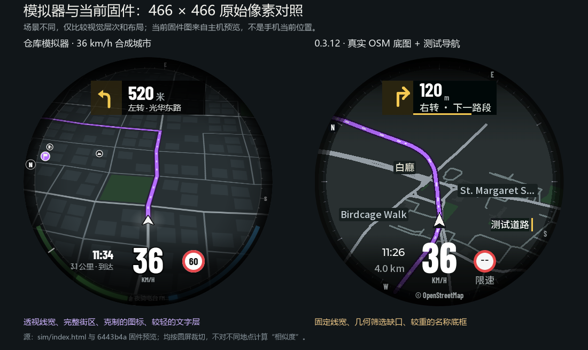
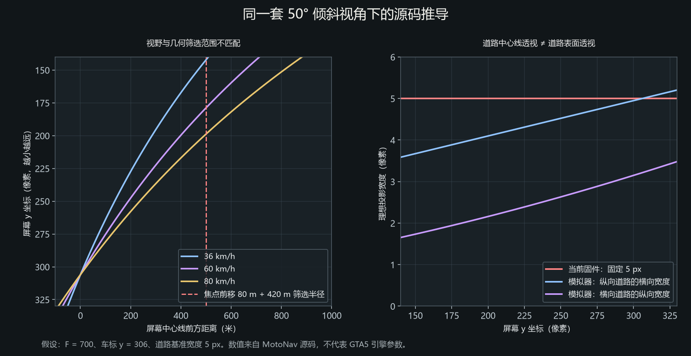

# MotoNav 显示差异审阅：仓库模拟器、0.3.12 与 GTA5 驾驶地图

日期：2026-11-17。基线：Android 0.7.20 / ESP32 0.3.12，源码提交
`6443b4a6bbdbc14c7e8eb0f60fa19e558eb97108`。用户已确认实际地图出现地名，
但尚未接受整体显示效果。本轮交付是分析、测量与修改顺序；未修改正式固件、
未重新刷写 COM21。

**结论。** 当前差距主要来自几何数据的筛选、道路表面的透视、路线前后关系、
图标与文字层次，最后才是阴影、字体和装饰。底色、50° 行驶视角、顶端转向卡片、
大号车速已经接近模拟器。单独继续增加地名，会在底图缺口仍然存在时增加遮挡和绘制负担。

左右均按 466×466 原始像素展示并按物理圆屏裁切。左侧是模拟器合成城市，右侧是
真实伦敦 OSM 底图搭配合成导航的主机预览，均不是用户当前位置。两图场景不同，
只用于比较布局与绘制方式；不能计算整体相似度或以建筑数量判断同一地点的数据完整度。

**测量方法与证据边界。**

- 核对云端 `main`、用户原目录及隔离工作目录中的 `sim/index.html`。换行符归一化后
  两个本地文件完全相同；云端文本长度与逐字符校验一致。归一化 SHA-256：
  `5c7c2a794394b29079cba6abe2c53b82bb443badf84bf4981b1d34296fd59fda`。
- 在浏览器中保留原有绘制代码，只向内存副本注入固定状态，等待字体加载，提取原始
  466×466 Canvas。没有改写仓库模拟器。覆盖停车俯视、18 km/h 转弯、36/60 km/h 自动视角、
  60 km/h 追尾视角。字体 Anton 和 Barlow Condensed 已实际加载。
- 按源码坐标、字体大小、投影公式核对固件；重放公开缓存瓦片的筛选流程，分别统计候选与输出。
- GTA5 使用官方手册和可核对的实机截图。官方视频页受到登录/年龄限制，本轮没有完成视频观看，
  因而不把缩放响应时间、精确倾角、帧率或停车切换阈值写成 GTA5 已验证参数。
- 浏览器截图与 RGB565 主机预览不包含面板光学、拍摄曝光和真实骑行定位误差；源码标称字号
  也不等于字形实际黑色包围框。下文分别标注源码尺寸、公式推导和截图观察。

**逐项像素和行为对照。**

| 项目 | 仓库模拟器 | 0.3.12 | 影响与判断 |
| --- | --- | --- | --- |
| 画布与行驶车标锚点 | 466×466；普通行驶 `(233,306)`，停车 y=270 | 同尺寸、同普通锚点 | 主布局无需推倒重做 |
| 行驶视角 | 普通最高 50°；独立 chase 61°、y=332 | 最高 50°；未暴露 chase 模式 | 现阶段差距并非缺少 61° 模式 |
| 缩放 | 12–80 km/h 对应 0.85–2.45 m/px | LIVE 目标公式相同；WAIT 固定 1.13 m/px | WAIT 是无有效指引时的构图预设，不能为了效果伪造速度 |
| 支路/主路 | 地面画布中 2.8 / 5 px，再整体透视 | 投影中心线后固定 3 / 5 px | 远处道路过粗、横向道路缺少压缩，是主要差异 |
| 高速道路 | 地面宽 6.5 px、外沿 10 px，再透视 | 固定 6 / 10 px | 远处与路口层次不同 |
| 导航路线 | 地面宽 8 px、外沿 13 px，再透视 | 屏幕固定 7 / 12 px | 只把 7 改成 8 不能解决透视不一致 |
| 已行驶路线 | `routePath(sim.s, ...)` 从当前进度向前绘制 | 手机保留约后方 500 m / 前方 1000 m，固件亮色绘制整个窗口 | 车后路线仍抢占注意力；应区分待行驶与已行驶 |
| 路线亮点 | 沿连续路径推进，dash 5/30，受时间驱动 | 各投影线段重新开始，步距 35 px、长 5 px，最多 48 段 | 线段接头的亮点相位不连续，且没有相同的时间流动效果 |
| 车标 | 内形 21×25 px；50° 时纵向缩至约 17 px；3.5 px 描边、半径 34 px 光晕 | 内形约 21×25 px，外形 26×31 px；不随倾角压缩，无对应光晕 | 视觉上偏高、偏硬；灰色历史位置语义仍须保留 |
| 普通 POI | 圆形图案，原始直径约 18.8 px（含描边），再乘 0.495–0.9 比例；多数无常驻名称 | 22×25 px 字符框，“油/P/餐/+/站/园”等 | 当前符号重量较大，字框不等同于图形图标 |
| 地图名称 | 原型主要依靠图标和单独道路/区域提示，没有为每条街常驻文字 | 18 px 字号、25 px 高、24–150 px 宽、不透明底框 | 名称需要保留，但应分层显示，不能全部采用同一种底框 |
| 名称预算 | 无同样的 24→8 文字规则；截图中的 POI 数随场景变化 | 手机最多 24 个，屏幕最多 8 组图标/文字 | 不能把“24 个已发送”理解成“24 个同时显示” |
| 转向卡片 | `(126,44)`，214×64 px；距离 Barlow 36、单位 16、副行 15 | 卡片位置尺寸一致；距离 36、单位 14、副行 CJK 18 | 中文行偏挤、截断更早；单位与基线仍需精修 |
| 速度/限速 | Anton 66；限速约 42 px 外径，中心约 `(318,382)` | Anton 66；限速 42 px、同一位置附近 | 字族和大尺寸已对齐；描边、ETA 和小字比例仍有差别 |
| 道路与区域提示 | 道路 20 px、区域 13 px；约 4.5 秒渐隐提示 | 只有 current_road，18 px、最大宽 135 px、单行底框 | 缺少区域提示及其出现/退场逻辑 |
| 环形 HUD | 罗盘、彩色状态弧及其他模拟事件 | 罗盘刻度与方向字母，未实现同等状态弧 | 属于次优先级；每个弧需先定义真实数据来源 |
| 抗锯齿与暗角 | Canvas 边缘覆盖、渐变雾和渐变暗角 | 地图几何硬边；RGB565 有序抖动，若干分段暗角 | 抖动改善色阶但不是几何抗锯齿，细线容易出现颗粒感 |
| 运动过渡 | 航向、缩放、倾角分别平滑，源码增益约 5/s、1.2/s、1.6/s | 位置、航向、缩放、倾角共同按 900 ms 线性插值 | 目标更新时过渡重新计时；动态感不同，不能仅靠静态图验收 |

底图标称配色已经一致：地面 `#283033`、建筑 `#313b3f`、主路 `#929ca1`、
水面 `#1e4560`、绿地 `#2a4430`、路线 `#b66dff`。面板量化与阴影仍会改变最终像素，
但改配色不能补回缺失的建筑、水面和道路表面。

**可直接定位的三个底层原因。**

1. **视野范围与手机选图范围脱节。** `LocalMapBuilder` 将筛选焦点向前移 80 m，
   再使用固定 420 m 距离门限。相机在高速时却显示更远的地面，且 `BasemapLoader`
   主要在移动超过 90 m 或转向超过 45° 后重新选图，没有速度/视野扩张条件。
   对于前方小物体，约 500 m 的保留范围难以覆盖整个可见区域。长道路和大多边形可能
   因局部靠近焦点而被保留到更远处，因此不能把 500 m 当成所有像素的硬裁切边界。

   源码公式推导：普通行驶 F=700、倾角 φ=50°、车标 cy=306；取 d=cy-y，
   地面前向像素 `gd = F*d / (F*cos(φ)-d*sin(φ))`，实际距离为 `gd*mpp`。
   在仍可见的 y=140 中心线上，36/60/80 km/h 对应约 **509 / 713 / 882 m**。
   应把屏幕轮廓反投影为地面可见范围，加入移动预取余量，再分配近中远细节。

2. **同一预算混放建筑、水面和绿地，且带洞建筑被跳过。** 用当前 Java 类重放公开
   伦敦瓦片，最终仍为 383 个几何图元。以下候选数已经通过半径、单组上限和候选队列
   筛选，但尚未应用最终 384 图元预算；计数单位是线段/三角面，绝不是建筑栋数。

   | 类别 | 最终选择前候选图元 | 发往设备的图元 |
   | --- | ---: | ---: |
   | 支路线段 | 231 | 109 |
   | 主路线段 | 91 | 83 |
   | 建筑三角面 | 1390 | 161 |
   | 水面三角面 | 14 | 0 |
   | 绿地三角面 | 240 | 30 |

   瓦片包含 1300 个建筑外环，其中 27 个带孔洞；当前逻辑跳过这类外环，19 个落在初步
   900 m 包围范围内。不能据此断言这 19 个都应出现在最终视野，但代码确实没有保留
   内院建筑的能力。单个对象超过 96 个输出图元也会整组舍弃。需要分别保留水域/绿地/
   主要建筑的空间骨架，支持带洞多边形、可见部分裁剪和按投影面积简化。
   此处是公开样本的确定结果，不代表用户所在区域具有相同建筑数量。

3. **只投影中心线，没有投影道路宽度。** 固件把中心线投影后画固定宽度的圆头线段；
   模拟器先画路面再透视。以 5 px 主路为例，y=140 时，模拟器理想投影后的纵向道路
   横向宽度约 **3.59 px**，横向道路纵向宽度约 **1.65 px**，当前固件均为 **5 px**。
   后者可达到约三倍视觉厚度。应对道路条带和路线条带做地面空间投影，并为接头、端点、
   裁切和亚像素边缘规定一致规则。单纯按照 y 缩放所有线宽也不足以处理道路方向差异。

**信息缺失还发生在哪些环节。**

- `VectorTile.Feature` 仅保留图层、kind、类型、坐标和名称。bool/数值属性没有保留，
  `bridge`、`tunnel`、`link`、`oneway` 等不能参与绘制。固件又按类别重新排序，无法可靠
  区分桥上/桥下。水系线、道路面、独立桥梁等层也没有进入现有几何集合。
- 当前使用的 Shortbread 1.0 官方格式最大 z14，更高客户端缩放是对 z14 放大。
  因此不能把“请求 z16”当作补齐细节的方案。官方格式已经定义桥/隧道/单行属性与图层
  排序，可先使用现有数据里已经有的内容。[官方 schema](https://shortbread-tiles.org/schema/1.0/)
- 名称被限制在半径 211、y=140..337 的区域；该区域仅约占物理圆面 **47.1%**，还要扣除
  路线、车标、道路 HUD 和其他标签。POI 名称放不下时，图标也一起消失；名称每轮贪心
  重新布局，缺少跨帧稳定策略。后者是可能产生跳动的机制，尚未测定用户实机跳动频率。
- 提供方没有记录的店铺、地名或建筑，设备无法从路线数据推导。应在本地诊断区分
  “瓦片本来没有”“筛选丢失”“已传输但被遮挡”；已有伦敦样本只能证明第二类确实存在。

**GTA5 驾驶地图的可验证做法与适用范围。**

官方手册明确：小地图显示邻近区域，会随人物朝向旋转，N 表示北方；区域名和当前道路名
由独立的 LOCATION 显示承担。这支持把局部路网、位置箭头与区域文字分开设计。
[GTA V 官方 Game Help](https://dlassets-ssl.xboxlive.com/public/content/4f0a3089-ba2c-4f3d-9e38-102a41cbd885/GameManual/bffef18e-3f19-4190-a9b1-75402359b13b/en-CA/index.html)

进一步观察两张游戏原始画面，而非依赖对游戏的二手描述：

| 样本 | 直接观察 | 可以迁移的设计原则 |
| --- | --- | --- |
| 2013 年第三人称驾车画面，1280×720 | 小地图约 x=60..238、y=560..675，箭头约 `(148,647)`；道路名 Boulevard Del Perro 在右下独立显示；地图内少量图标、街区形状清楚 | 该帧箭头约位于局部地图宽度 49%、高度 76% 处，给前方更多空间；这是单帧测量，不是所有模式的固定锚点 |
| 2022 年 Xbox Series X 评测驾驶截图，3840×2160 | 第一人称驾驶，半透明透视地图，白色深描边箭头，黄色路线及 0.53 mi 提示；街区/道路连续，没有密集名称底框 | 地面道路表面也参与透视；路线颜色与底图分离；名称与符号不遮住主要路口 |

第一张图来自 [Version Museum 的游戏画面档案](https://www.versionmuseum.com/history-of/grand-theft-auto)，
仅使用截图像素作为证据，不采用其历史叙述。第二张来自作者基于 Rockstar 提供的评测版本
制作的 [The Koalition 评测](https://thekoalition.com/2022/grand-theft-auto-v-online-next-gen-review-the-open-world-g-o-a-t)，
[原始驾驶截图](https://thekoalition.com/images/2022/03/gta5-driving.png)。

第二张图中，对同一前进路线的黄色核心做固定颜色阈值计数：y=1670 为 10 px，
y=1750 为 15 px，y=1880 为 23 px，支持“远细近粗”的观察。该计数只描述这张原始图，
不包含抗锯齿边缘，不代表 GTA5 的固定线宽。原图 SHA、阈值、六个取样行保存在
`gta-observations.json`。截图中的路线是黄色，不能把紫色描述为所有 GTA5 导航的统一规则。

据此，MotoNav 适合沿用：局部前向视野、道路/街区清楚分层、醒目的有效位置箭头、
待行驶路线最高优先级、小型图案 POI、单独的当前道路/区域提示。应保留仓库已经确定的
暗色主题和紫色路线；游戏截图里的灰色地图与半透明背景无需原样搬到实体圆屏。

以下属于 MotoNav 模拟器自己的设计，不能由本轮证据宣称是 GTA5 原版规格：
圆屏、大号车速、限速圆牌、转向卡片、速度状态弧、50°/61°、6–22 km/h 倾斜过渡阈值、
路线流动点，以及各种音乐/任务/车队模拟事件。原型里的注释不是游戏引擎技术资料。
透视地图也不等于把游戏 3D 场景搬进设备；本轮所需主要是平面几何的透视表现。

**实现顺序与模块边界。**

| 顺序 | 应完成的内容 | 所属模块与接口约束 | 验收依据 |
| --- | --- | --- | --- |
| P0：先恢复地图结构 | 相机可见范围驱动选图；水域、绿地、街区分别预算；内院孔洞处理；近中远简化 | Android `ViewFootprint` / `MapDetailSelector`，输入相机与真实要素，输出有界 scene；先保持现有 384 上限 | 同一公开瓦片不再因为共享队列把所有可见水域挤掉；视野上沿没有筛选造成的突兀缺口 |
| P0：修正路面与路线 | 道路条带投影；路线接头连续；明确待行驶与已行驶部分 | ESP `RoadMesh` / `RoutePresenter`；可靠路线进度由手机提供，不能在自交路线中仅凭最近点猜测 | 相同输入下路宽随深度/方向变化；箭头前方路线突出，车后路段淡化或隐藏 |
| P0：同步控制帧时 | 分层计时、投影结果缓存、可见带索引、有限抗锯齿、近远 LOD | graphics 层；新增大缓存优先评估有界 PSRAM，保持 DMA 缓冲要求；不把地图逻辑放进驱动 | 先达到至少 40 FPS 的明确实测口径；不能以测试场景变稀疏来代替优化 |
| P1：重做符号与名称 | 小型图形图标；道路名减轻底框；名称放不下仍可留图标；稳定排序与迟滞 | `MapAnnotations`，图标与文字预算独立；先复用 NAV4S5，新增字段再协商能力 | 同路线、同视角转动时图标稳定；无撞车标、转向卡片或关键路口 |
| P1：完善 HUD | 道路/区域双层提示、中文副行字号和基线、ETA/剩余距离比例、车标形状和描边 | `NavigationHud` / `MapTheme`；对未知速度、限速、区域保持明确未知 | 固定场景按像素锚点比对；区域名必须来自真实数据 |
| P2：调整动态感 | 航向、缩放、倾角独立平滑；连续路线亮点；有数据来源的状态弧 | `CameraPolicy` 与 `RoutePresenter` 独立；不改导航有效性判断 | 转弯连续、无标签闪跳；GPS 弱时仍保留明确的历史位置语义 |

这些是建议的模块职责，不表示新类已实现。现有应用层、graphics、协议、显示驱动总体可
继续分开演进。首批相机/筛选/样式修正可在已有协议容量内推进；桥隧、稳定要素 ID、
明确路线进度、区域字段如果超出现有编码，再设计可回退的新能力，避免一次性扩大所有数据结构。
驱动层只负责提交像素、DMA 和完成通知，不负责辨认道路、名称或导航状态。

不能直接照搬浏览器的 1200×1300 中间画布：单张 RGB565 约 2.98 MiB，还包含逐行采样和
叠加成本。条带道路网格、局部缓存或纹理方案需要在 ESP32 上 A/B 测量，不能把浏览器流畅
当作设备可达到相同性能的证明。

**性能边界与验收方式。**

0.3.12 的既有 COM21 标注地图测试为 RGB565 / 40 MHz QSPI / 双 64 行缓冲，
40.534 秒计时段最低 18、平均 23 FPS；延长观察最低到 15 FPS。记录的 render 约
37.766 ms/帧，DMA 约 19.808 ms/帧，两阶段有重叠，不能直接相加。
连接手机并加载地图后内部空闲堆约 5.3 KB；文本缓存已占用约 653 KiB 外部内存。
详见 [0.3.12 验证记录](map-labels-0.3.12-validation.md)。这些是既有测量，非本轮新跑的帧率。

40 FPS 的帧预算是 25 ms。下一轮应以最慢阶段不超过预算为约束，并为 BLE、调度留余量，
例如先把 render 优化到约 22 ms 内，再测整帧持续表现。不能只增加建筑数量或 LVGL 标签。
现有约 19.8 ms 的 DMA 时长也不足以支撑全画面 60 FPS 的结论。

建议把验收改成固定输入的连续对照，而非每版分别查看不同地点：

1. 同一份真实地图几何、同一路线、同一相机状态同时送给 Web 参考渲染器和 ESP 主机渲染器；
   目前本报告首图还不具备这种同场景条件。先核对锚点、线宽、遮挡，之后才计算误差。
2. 固定停车、18/36/60/80 km/h、直行、90° 转弯、环岛/自交、跨桥、地图窗口切换等输入；
   目标锚点误差不超过 1 px，主路/路线宽度按方向和深度抽样，给 RGB565/抗锯齿留明确容差。
3. 在手机连接、持续导航数据和诊断并行时跑代表性稠密地图，记录整帧分位耗时、最低/平均 FPS、
   堆和任务栈。是否“至少 40 FPS”以持续帧时和卡顿数据决定，不只看一项平均值。
4. 单独验证 GPS 弱、历史位置、恢复定位、重规划和断连；平滑算法不能让失效坐标继续前进，
   也不能为了像模拟器而生成地名、速度、限速或假道路。

**源码核对入口。** 以下行号对应上述基线提交。

| 位置 | 核对内容 |
| --- | --- |
| `sim/index.html` 459、557–567、606–683 | 视角、平滑、道路/路线宽度、Mode 7 |
| `sim/index.html` 699–759、795–824、968–1068 | 图标、车标、卡片、速度、区域提示 |
| `android-recovery/.../LocalMapBuilder.java` 25–47、64、86–119 | 焦点、420 m、孔洞、复杂度和类别预算 |
| `android-recovery/.../VectorTile.java` 11、28–36、49–58 | 保留的属性与图层 |
| `android-recovery/.../BasemapLoader.java` 32–68 | 选图触发与渐进发布 |
| `android-recovery/.../DeviceRoute.java` 82–119 | 前后路线窗口和位置 |
| `moto_esp32/components/motonav_graphics/route_map.cpp` 77–83、111–125、298–327 | 车标、固定线宽、排序、分段亮点 |
| `moto_esp32/components/motonav_ui/map_annotations.cpp` 11–14、37–54、83–110 | 可放置区域、底框、图标/文字共同淘汰 |
| `moto_esp32/components/motonav_ui/navigation_ui.cpp` 108–129 | 相机目标与 900 ms 过渡 |
| `moto_esp32/components/motonav_ui/navigation_hud.cpp` 35–68 | HUD 像素尺寸及字体 |

`android-recovery/...` 的完整包目录为 `app/src/main/java/com/motonav/companion/`。

随报告保存的证据：`assets/visual-audit-20261117/` 中的两张分析图、五张模拟器原始 PNG、
固件主机预览、`sim-measurements.json`、`geometry-analysis.json`、`gta-observations.json`、
`tile-detail-audit.txt`、源码核对与文件 SHA 清单。图像数据中的真实 OSM 底图遵循
[原测试样本来源与许可](../moto_esp32/tests/fixtures/REAL_MAP_SOURCE.md)。外部游戏原图只保留
来源链接与取样结果，不纳入固件或资源包。
